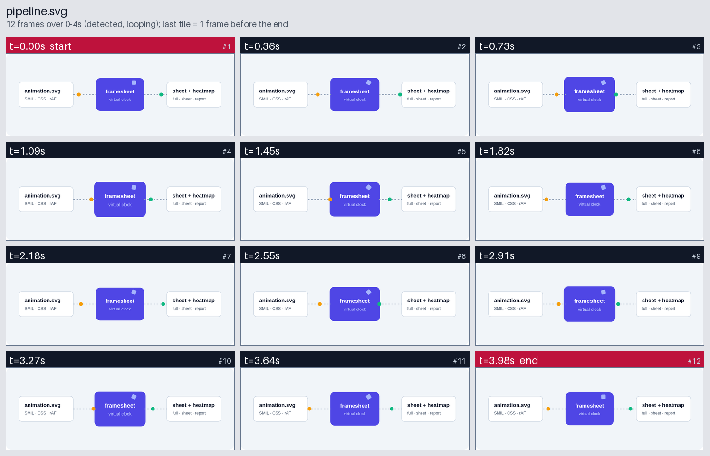
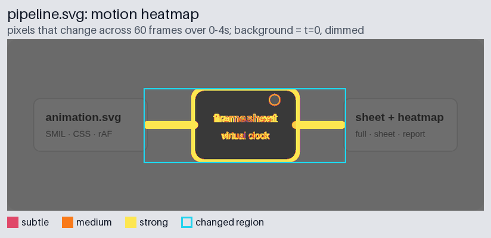
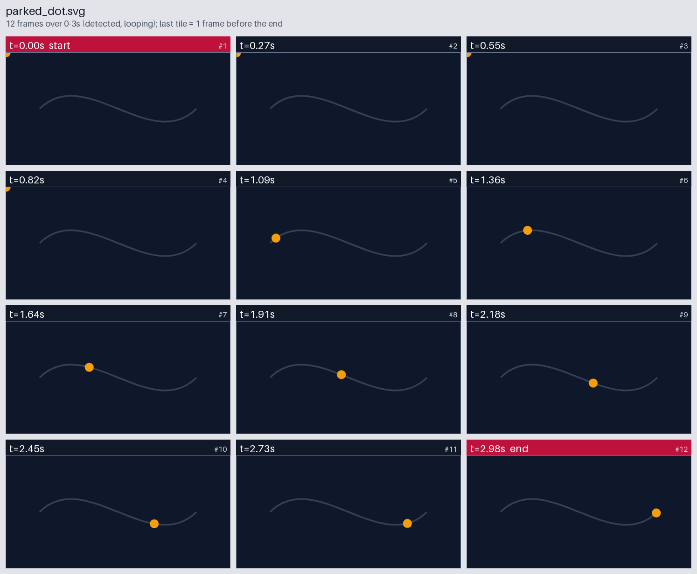
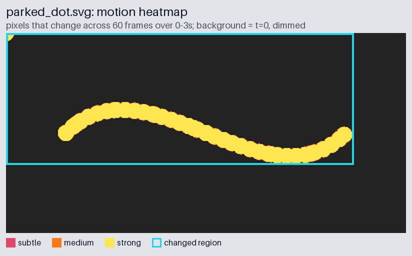
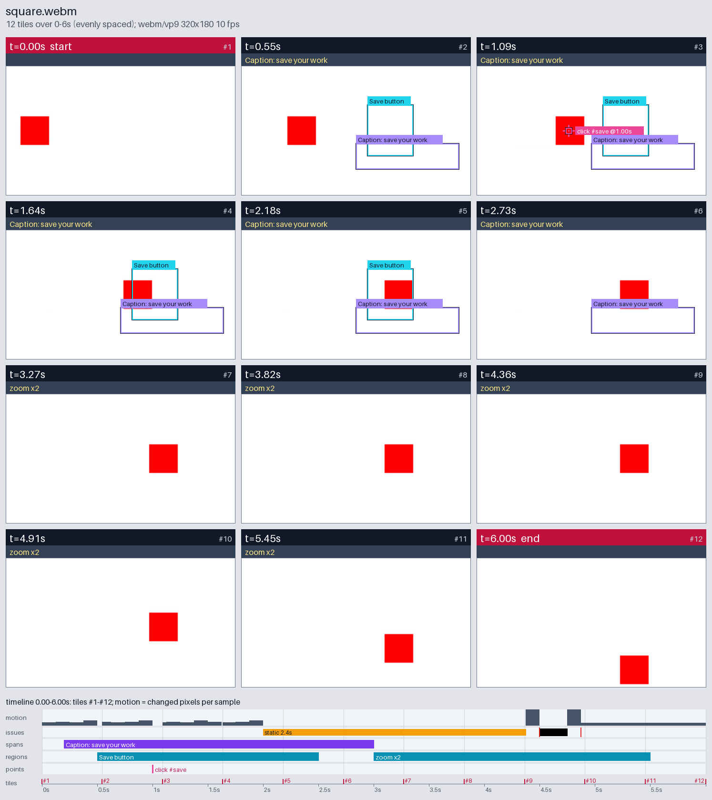

# framesheet

[](https://pypi.org/project/framesheet/)
[](https://pypi.org/project/framesheet/)
[](https://pypi.org/project/framesheet/)
[](https://pypi.org/project/framesheet/)
[](https://pypi.org/project/framesheet/)
[](https://pypi.org/project/framesheet/)
[](https://pypi.org/project/framesheet/)
[](https://github.com/phil65/framesheet/releases)
[](https://github.com/phil65/framesheet/graphs/contributors)
[](https://github.com/phil65/framesheet/forks)
[](https://github.com/phil65/framesheet/issues)
[](https://github.com/phil65/framesheet/pulls)
[](https://github.com/phil65/framesheet/watchers)
[](https://github.com/phil65/framesheet/stars)
[](https://github.com/phil65/framesheet)
[](https://github.com/phil65/framesheet/commits)
[](https://github.com/phil65/framesheet/releases)
[](https://github.com/phil65/framesheet)
[](https://github.com/phil65/framesheet)
[](https://codecov.io/gh/phil65/framesheet/)
[](https://pyup.io/repos/github/phil65/framesheet/)

[Read the documentation!](https://phil65.github.io/framesheet/)

**framesheet** renders an animated SVG or HTML page at exact, evenly spaced points in
virtual time and turns them into images you (or an AI agent) can check at a glance. It
does the same for videos and animated GIFs (see [Video input](#video-input)).

An agent can only look at still images, and one screenshot shows one moment. A dot that
sits at `(0,0)` for the first second, a label that overflows its card, a box that flies
off the canvas halfway through, a loop that jumps back at the end: none of these show up
reliably in a single screenshot. framesheet captures the whole cycle, frame-accurately
and deterministically (same input, same PNG bytes), and adds numbers to back it up.

## What you get

For every input, in the output directory:

| File | Use it for |
| --- | --- |
| `full.png` | One full-resolution frame (default `t=0`, `--at SECONDS`): layout, text, margins. |
| `sheet.png` | Contact sheet: N frames (default 12) over one cycle, each labelled `t=0.50s`. The last tile is one 60 fps frame before the cycle end, so you can judge the loop against the first tile. |
| `heatmap.png` | Motion heatmap: every pixel that changes at any time, coloured over a dimmed first frame. Shows what moves at all, including things that should not. |
| `report.json` | Detected duration and how it was found, static findings, per-frame changed-pixel ratios, bounding boxes of animated elements, elements outside the viewBox or at `(0,0)`, loop seamlessness. |

A short summary is printed to stdout (`--json` prints the report instead).

Contact sheet of [`tests/fixtures/pipeline.svg`](tests/fixtures/pipeline.svg) (SMIL dots,
a pulsing CSS hub and a spinning badge; detected cycle: LCM of 2s and 4s):



Its motion heatmap:



And a buggy one, [`tests/fixtures/parked_dot.svg`](tests/fixtures/parked_dot.svg):
`<animateMotion begin="1s">` leaves the dot parked in the top-left corner for a second.
Tiles 1-4 show it, the heatmap marks the corner, and the report says
`parked-at-origin: circle#dot sits at the SVG origin (0,0) at t=0.00s, 0.27s, 0.55s, 0.82s`.





## Install

```bash
uv tool install framesheet        # or: pip install framesheet
framesheet install-browser        # downloads Playwright's Chromium (once)
```

`framesheet install-browser` runs `python -m playwright install chromium` in framesheet's
own environment, so the browser matches the installed Playwright version. In a project
environment, `uv run playwright install chromium` does the same. On a bare Linux CI
runner add `--with-deps` (`uv run playwright install --with-deps chromium`).

## CLI

```bash
framesheet inspect banner.svg                    # writes to a new temp dir, prints it
framesheet inspect banner.svg --out /tmp/check   # choose the output dir
framesheet inspect banner.svg -n 16 --at 1.25    # 16 tiles, full.png at t=1.25s
framesheet inspect page.html --size 1440x900 --scale 2
framesheet inspect canvas.html --duration 4      # JS-driven: give the cycle length
framesheet inspect a.svg b.svg --out /tmp/all    # one subdirectory per input
cat snippet.svg | framesheet inspect -           # SVG or HTML snippet on stdin
framesheet inspect https://example.com/anim.html
framesheet inspect banner.svg --json | jq .loop
```

Options: `--frames/-n`, `--duration`, `--at`, `--size WxH`, `--scale`, `--out/-o`,
`--tile`, `--columns`, `--keep-frames` (also write every frame to `frames/`), `--dark`
(`prefers-color-scheme: dark`), `--heat-frames`, `--channel` (browser channel, e.g.
`chrome`), `--json`. For videos also `--every`, `--times`, `--start`, `--end`, `--marks`,
`--static-stretch` (see [Video input](#video-input)). The exit code is 1 if an error-level finding
was reported (for example malformed XML or a broken `#id` reference), 2 for usage
problems or a missing browser, 0 otherwise.

Example summary:

```text
framesheet: tests/fixtures/non_seamless.svg (svg, 400x200 @1x)
duration: 3s detected: loop period 3s (1 animation(s): css-animation) [looping]
frames: 12 at t=0.00..2.98s; max change 2.8% at t=2.45s
loop: NOT seamless (last frame -> first frame changes 4.73% of pixels, one normal step changes 0.40%)
animated elements: circle#runner
findings: 0 error(s), 1 warning(s), 0 info
  WARN  [render] non-seamless-loop: The loop jumps at the cycle end: ...
images:
  full     /tmp/framesheet-x1y2/full.png  (t=0s: layout, text, margins)
  sheet    /tmp/framesheet-x1y2/sheet.png  (motion over one cycle)
  heatmap  /tmp/framesheet-x1y2/heatmap.png  (what moves at all)
  report   /tmp/framesheet-x1y2/report.json
```

## Python API

```python
import framesheet

result = framesheet.inspect("banner.svg", frames=12, out="/tmp/check")
print(result.summary())
print(result.duration.seconds, result.duration.detail)
print(result.loop.seamless, result.images.sheet)
for finding in result.findings:
    print(finding.severity, finding.code, finding.element, finding.times)

# Markup strings work too (anything starting with "<").
framesheet.inspect('<svg xmlns="http://www.w3.org/2000/svg" viewBox="0 0 10 10">...</svg>')

# Videos: same call, plus range/sampling/marks options.
demo = framesheet.inspect("demo.mp4", every=1.0, marks="marks.json", static_stretch=1.5)
for tile in demo.video.tiles:
    print(tile.t, tile.media_time, tile.black, tile.duplicate, tile.sharpness, tile.marks)
```

`inspect()` returns an `InspectionResult` (pydantic model): image paths, `duration`,
`times`, `frames` (per-frame metrics), `elements` (per-frame boxes of animated elements),
`video` and `marks` (videos only),
`loop`, `findings` and `console_errors`. It uses Playwright's sync API, so call it
outside a running asyncio loop (or in a worker thread).

## JavaScript / TypeScript (npm)

The npm package [`framesheet`](js/README.md) (in [`js/`](js/)) is a TypeScript port with
the same in-page runtime, report schema and image layout, for Node/Bun servers and
Playwright e2e suites:

```ts
import { inspect, inspectPage } from "framesheet";
import { expectAnimation } from "framesheet/test";

const result = await inspect("banner.svg", { frames: 12 });  // PNG buffers + report
await expectAnimation(page.locator("#mindmap"), "mindmap-open", { frames: 8 }); // visual regression
```

See [js/README.md](js/README.md) for `inspectPage` (components in a running app),
`prepare` (fake clock for JS-driven motion) and server notes.

## The agent loop

1. Run `framesheet inspect FILE --out DIR`.
2. Read the summary, fix every `ERROR` and `WARN`.
3. Look at `full.png` for layout: text clipping, cramped margins, connectors meeting
   card edges, contrast.
4. Look at `sheet.png` for motion: does every tile look intentional? Do the first and
   last tile join up for a loop?
5. Look at `heatmap.png` for unexpected movement: anything coloured that should be still?
6. Use `report.json` for numbers (boxes per frame, changed-pixel ratios, seam ratio).
7. Re-run until clean.

## Video input

framesheet also inspects **videos and animated images**: `.mp4`, `.mov`, `.webm`, `.mkv`,
animated `.gif` and `.webp`, as a file path or URL. An agent cannot watch a video, but it
can look at a contact sheet and read numbers, so the loop "render video -> inspect ->
adjust -> re-render" works the same way as for SVG.

```bash
framesheet inspect demo.mp4                         # 12 tiles over the whole video
framesheet inspect demo.mp4 --every 1               # one tile per second
framesheet inspect demo.mp4 --times 1.2,3.4,7       # tiles at exact times
framesheet inspect demo.mp4 --start 5 --end 9 -n 9  # a range
framesheet inspect demo.mp4 --marks marks.json      # draw clicks, targets, zooms, captions
framesheet inspect demo.mp4 --marks marks.json --times marks  # one tile per mark
framesheet inspect demo.mp4 --static-stretch 1.5    # report dead time over 1.5 s
```

Same outputs: `full.png` (the frame at `--at`, default the range start), `sheet.png` (tiles
over the range, plus a **timeline strip** under the grid), `heatmap.png` (what changes at
all over the range) and `report.json`, which gains a `video` section:

- `container`, `codec` (`h264`, `hevc`, `vp8`, `vp9`, `av1`, `gif`, `webp`), `decoder`,
  `width`, `height`, `media_duration`, `fps`, `frame_count` (read from the container
  without ffmpeg; best effort), the inspected `start`/`end`;
- `samples`: every sampled time (tiles plus a dense grid, at most 0.25 s apart and up to
  240 samples; `heat_frames` sets the minimum) with the share of pixels changed since the
  previous sample;
- `tiles`: per tile `media_time` (the decoded frame's presentation time), `black`,
  `blank`, `duplicate` (near-identical to the previous tile), `sharpness` (mean luma
  gradient: compare tiles of one video, drops mean motion blur or upscaling) and the labels
  of the active `marks`.

Video findings (stable codes): `video-static-stretch` (no visible change for longer than
`--static-stretch`, default 2 s: dead time), `video-black-frames`, `video-blank-frames`
(one flat colour, e.g. a white page before load), `video-abrupt-cut` (info: one step
changes >= 40% of the pixels while its neighbours are quiet: a hard cut or a zoom that
jumps instead of easing) and `video-mark-overlap` (a span box such as a caption covers an
active `target` region box). `no-motion` and `console-error` apply as for pages.

The timeline strip shows, over the full range: a **motion** lane (changed pixels per
sample), an **issues** lane (static stretches in amber, black/blank frames, cuts in red),
**spans**, **regions** and **points** lanes from the marks, and the **tile axis** (tile
numbers above, seconds below; light guides mark each tile's time in every lane).

### Marks

`--marks marks.json` ([schema](schema/marks.schema.json)) annotates the video, generic
enough for any recording tool to write:

```json
{
  "frame": {"width": 1920, "height": 1080},
  "points":  [{"t": 1.2, "x": 384, "y": 640, "label": "click #save", "kind": "click"}],
  "regions": [{"start": 1.0, "end": 2.5, "x": 148, "y": 251, "w": 448, "h": 62,
               "label": "Save button", "kind": "target"},
              {"start": 1.6, "end": 8.6, "label": "zoom x2", "kind": "zoom"}],
  "spans":   [{"start": 0.7, "end": 3.7, "label": "Add a task in seconds", "kind": "caption",
               "x": 560, "y": 900, "w": 800, "h": 110}]
}
```

- Times are seconds of the media. Coordinates are fractions (0-1) of the video frame, or
  pixels of `frame` when it is given; they refer to the **output** frame (after any zoom).
- `points` (`t`, `x`, `y`, optional `label`, `kind`, `duration`): drawn as a crosshair
  with its label on the tile nearest to `t` (with `duration`: on every tile it overlaps).
- `regions` (`start`, `end`, optional box `x, y, w, h`, `label`, `kind`): a box is outlined
  on every tile inside the range; a region without a box (e.g. a zoom) is listed in the
  tile's mark band. `kind: "target"` boxes are checked against span boxes.
- `spans` (`start`, `end`, `label`, optional box and `kind`): the label appears in the mark
  band of every tile inside the range; a box (the caption's screen area) is outlined.
- A box is all four of `x, y, w, h` or none; `end >= start`; boxes must lie in the frame.
- `--times marks` puts one tile at each point's `t` and each region's/span's midpoint.

### The demo video optimization loop

For scripted product demos (record -> zoom/cursor -> MP4), inspect every render with the
scenario's marks and fix the first problem before re-rendering:

1. **Summary/report first.** `video-static-stretch` = dead time (shorten the pause or
   speed up); `video-blank-frames`/`video-black-frames` at the start = recording began
   before the page painted (trim); `video-mark-overlap` = a caption covers the element being
   clicked (move the caption); `video-abrupt-cut` inside a zoom region = the zoom jumps
   instead of easing.
2. **Sheet, tile by tile.** Is the click crosshair on the target outline at the click time?
   Is the target inside the frame during its zoom (not cropped away)? Is the caption
   readable and clear of the action? Does each tile look intentional?
3. **Timeline.** Motion should cluster inside regions and around points; long flat motion
   between actions is dead time, motion where nothing is marked is unplanned. Spans should
   not start before the thing they describe is visible.
4. **Heatmap.** Motion should be where the actions are. A cursor wandering across the
   whole frame or flicker in a static area shows up immediately.
5. **Numbers.** `tiles[].sharpness` dropping during zooms = motion blur or upscaling;
   `duplicate` tiles in a row = pacing too slow; `samples` lets you compute anything else.

### How frames are seeked (and codecs)

No ffmpeg: the video is played in Chromium. framesheet serves a minimal page and the media
from a virtual origin (with HTTP range support). For `<video>` formats, it sets
`video.currentTime = t` on a muted, paused element, awaits `seeked` and the next presented
frame (`requestVideoFrameCallback`), and draws the frame into a canvas that fills the
viewport (object-fit contain on black). Animated GIF/WebP are decoded with WebCodecs
`ImageDecoder`: the frame whose `[timestamp, timestamp + duration)` contains `t` is drawn.
The viewport defaults to the video's intrinsic size (`--size` letterboxes it); the report's
`canvas` is where the frame sits. Frames are deterministic for the same file and browser.

Codecs: VP8/VP9/AV1 in WebM (and MP4), GIF and WebP always work in Playwright's Chromium.
H.264/HEVC depend on the build: Playwright's Chromium decoded H.264 in our tests (1.65), but
open-source Chromium builds may lack proprietary codecs. framesheet then explains the
error; re-encode to VP9 (`ffmpeg -i in.mp4 -c:v libvpx-vp9 -crf 32 -b:v 0 out.webm`) or use
an installed Chrome with `--channel chrome`. Animated images need `ImageDecoder` (Chromium
>= 94); there is no `` fallback, whose timing cannot be controlled.

Contact sheet of [`tests/fixtures/square.webm`](tests/fixtures/square.webm) with
[`square.marks.json`](tests/fixtures/square.marks.json) (a square that moves, stands still
for 2.4 s, a black flash, moves again; a caption over the target box):



## How time is controlled

framesheet never takes wall-clock screenshots. Everything runs on a virtual clock:

- **SMIL**: `pauseAnimations()` + `setCurrentTime(t)` on every outermost `<svg>`.
- **CSS animations/transitions and Web Animations**: every `document.getAnimations()`
  entry is paused and its `currentTime` set to `t`.
- **JavaScript** (`requestAnimationFrame`, canvas, `Date`, `performance.now`, timers):
  Playwright's fake clock is installed before the page loads and only advances when
  framesheet moves to the next sample time, firing every due timer and rAF callback.

The cycle length is detected from SMIL `begin`/`dur`/`repeatCount` and CSS/Web Animation
timing (delay + duration x iterations, alternate = 2x duration, several loops = least
common multiple when short enough). Override it with `--duration`; with no declarative
animation framesheet samples 3 seconds and tells you so.

## Checks

Static checks (ported from the `svg-animation` skill's `verify_svg.py`): malformed XML,
missing `xmlns`/`viewBox`/title, `<script>`, `on*` handlers, external URLs and fonts,
`<foreignObject>`, duplicate ids, broken `#id`/`url(#id)` references, positive
`<animateMotion begin>`, missing `prefers-reduced-motion`, CSS transforms without
`transform-box`, large files.

Render checks (from geometry at every sampled frame): `parked-at-origin`,
`outside-bounds`, `text-overflow` (SVG text vs. the rect under it; HTML text larger than
its box), `svg-transform-box` (CSS transform animation pivoting around the SVG origin),
`non-seamless-loop`, `js-driven-motion`, `console-error`.

## Repository layout

| Path | What |
| --- | --- |
| `src/framesheet/` | Python package (PyPI `framesheet`) |
| `src/framesheet/runtime.js` | In-page time-control runtime, **shared**: the npm build embeds it byte for byte (CI checks) |
| `js/` | npm package `framesheet` (TypeScript, Playwright peer dependency) |
| `schema/report.schema.json` | JSON Schema of `report.json`, generated from the pydantic models; both implementations are tested against it |
| `schema/marks.schema.json` | JSON Schema of `marks.json` (`--marks`) |
| `src/framesheet/video.js` | In-page video player for video inputs, **shared** like runtime.js |
| `schema/golden/` | Python reports for the fixtures (and `layout/`: marks/timeline draw ops); the npm tests compare against them |
| `tests/fixtures/` | Deliberately flawed SVG/HTML and tiny videos (`scripts/video_fixtures.py`), used by both test suites |

## Limitations

- Chromium only. Fonts are whatever the machine has, so text widths can differ from
  macOS/Windows; leave slack in text containers.
- Animations created by script after load are timed from the sample at which framesheet
  first sees them (accurate to one sample step).
- JS clocks run about 17 ms (one frame) ahead of SMIL/CSS time so that rAF content has
  painted at `t=0`.
- Content outside the viewBox is clipped in the images; the report still lists it.
