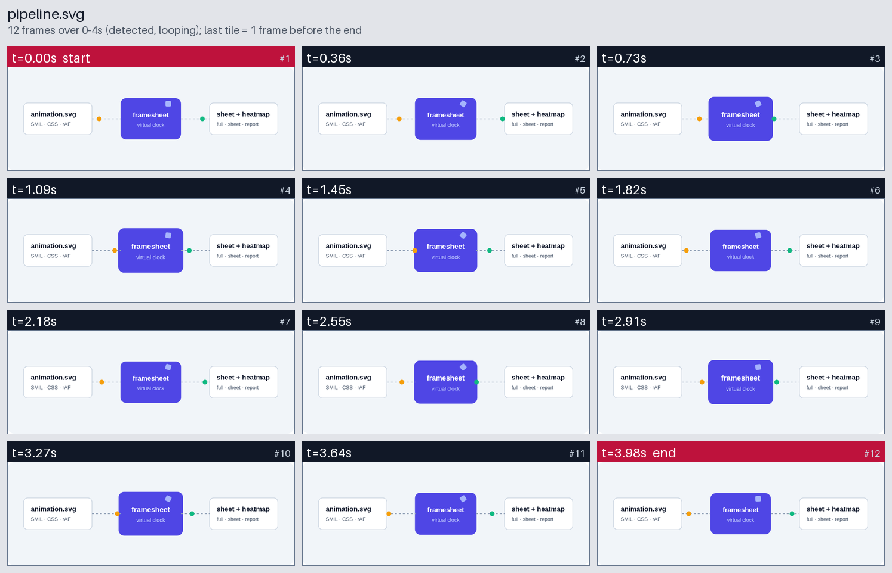

# framesheet (npm)

Frame-accurate contact sheets, motion heatmaps and checks for animated SVG/HTML, and for
animated components in a running web app. TypeScript port of the Python package
[`framesheet`](https://pypi.org/project/framesheet/): same in-page time control
(`runtime.js`, shared byte for byte), same report schema, same image layout. Use it in a
Playwright e2e suite for visual regression of animations, or in a Node server so an AI
agent can look at the SVG/HTML it generated.

An agent (or a reviewer) can only look at still images, and one screenshot shows one
moment. framesheet renders the whole cycle at exact virtual times and returns:

| Image | Use it for |
| --- | --- |
| `full` | One full-resolution frame (default `t=0`, `at`): layout, text, margins. |
| `sheet` | Contact sheet: N frames over one cycle, each labelled `t=0.50s`. The last tile is one 60 fps frame before the cycle end, so the loop seam is visible. |
| `heatmap` | Every pixel that changes at any time, coloured over a dimmed first frame. |
| `report` | Duration and how it was found, findings (stable codes), per-frame changed-pixel ratios, boxes of animated elements, loop seamlessness. Schema: `framesheet/schema/report.schema.json`. |



## Install

```bash
npm install -D framesheet playwright-core     # or: bun add -d framesheet playwright-core
npx playwright install chromium               # once (Linux CI: --with-deps chromium)
```

`playwright-core` (>= 1.45) is a peer dependency: framesheet uses your Playwright and its
browsers. A project that already has `@playwright/test` or `playwright` has it. ESM only,
Node >= 20 or Bun. No native dependencies (PNG decoding is pure JS; the sheet and heatmap
are drawn on a canvas in the same Chromium, with the font the Python images use).

## `inspect()`: a file, markup string or URL

```ts
import { inspect } from "framesheet";

const result = await inspect("banner.svg", { frames: 12 });
console.log(result.summary());            // same text as the Python CLI
result.images.sheet;                      // PNG Buffer (also full, heatmap)
result.report.loop.seamless;              // report.json content (snake_case, shared schema)
for (const f of result.findings) console.log(f.severity, f.code, f.element, f.times);

await inspect('<svg xmlns="http://www.w3.org/2000/svg" viewBox="0 0 10 10">...</svg>');
await inspect("https://example.com/anim.html", { size: [1440, 900], scale: 2 });
await inspect("canvas.html", { duration: 4, out: "/tmp/check" }); // also writes the files
```

Options: `frames` (2-100, default 12), `duration` (s; detected if omitted), `at` (s, time
of `full`), `size` (`[w, h]`), `scale`, `tile`, `columns`, `heatFrames` (default 48),
`keepFrames`, `colorScheme`, `out` (write `full.png`, `sheet.png`, `heatmap.png`,
`report.json`; without it nothing touches the disk), `timeout` (ms), `browser` (reuse a
launched `Browser`; a fresh context is used per call), `launchOptions`, `blockNetwork`
(abort every request except the input: use it for untrusted markup). Videos only: `every`,
`times`, `start`, `end`, `marks`, `staticStretch` (see below).

The result is an `Inspection`: `report`, `images` (`full`, `sheet`, `heatmap`,
`frames?`), `files` (paths, with `out`), `findings`, `errors`, `warnings`, `codes()`,
`summary()`. Output is deterministic: same input, same environment, same PNG bytes.

## Videos and animated images

`inspect()` also takes `.mp4`, `.mov`, `.webm`, `.mkv` and animated `.gif`/`.webp` (path
or URL). Same images and report, plus a timeline strip under the sheet and a `video`
section in the report (same schema as Python):

```ts
const r = await inspect("demo.mp4", {
  every: 1,                 // or frames: 12, or times: [1.2, 3.4] / "marks"
  start: 0, end: 15,        // range (default: the whole media)
  marks: "marks.json",      // or an object; validated (framesheet/schema/marks.schema.json)
  staticStretch: 1.5,       // seconds without change reported as video-static-stretch
  launchOptions: { channel: "chrome" }, // only if your Chromium lacks H.264
});
r.report.video!.tiles;      // media_time, black, blank, duplicate, sharpness, marks per tile
r.report.video!.samples;    // dense pacing samples: t, changed_ratio
```

Findings: `video-static-stretch`, `video-black-frames`, `video-blank-frames`,
`video-abrupt-cut` (info), `video-mark-overlap` (a span box, e.g. a caption, covers an
active `target` region box). Frames are seeked exactly: `<video>` `currentTime` + `seeked`
+ `requestVideoFrameCallback`, animated images via WebCodecs `ImageDecoder`; the frame is
drawn on a canvas filling the viewport (shared `video.js`, byte-identical to the Python
package's). No ffmpeg. Playwright's Chromium always decodes VP8/VP9/AV1, GIF and WebP;
H.264/HEVC depend on the build (re-encode to VP9 or use `channel: "chrome"`).

Marks schema, the timeline and the "demo video optimization loop" (what to look for in
the sheet, heatmap, timeline and report) are documented in the
[main README](https://github.com/phil65/framesheet#video-input). Helpers for tools that
write marks: `parseMarks`, `loadMarks`, `MarksError`, `planTimes`, `probe` (container
facts without a browser).

## `inspectPage()`: a page or component you already have open

```ts
import { inspectPage, prepare } from "framesheet";

const result = await inspectPage(page, {
  locator: page.locator("#mindmap"),   // optional: one component (also inside an iframe)
  frames: 8,
  trigger: () => page.getByRole("button", { name: "Open" }).click(),
});
```

What works where:

| Motion | Works on any page, any time | Needs `prepare(page)` **before** `goto` |
| --- | --- | --- |
| SMIL (`<animate>`, `<animateMotion>`, ...) | yes: paused and seeked per frame | |
| CSS animations and transitions | yes: `document.getAnimations()` seeked | |
| Web Animations (`el.animate`) | yes, same | |
| `requestAnimationFrame`, timers, `Date`, `performance.now` (canvas, spring/rAF animation libraries) | runs on real time: frames are not exact | yes: Playwright's fake clock is stepped per frame |

- `prepare(page)` installs Playwright's fake clock before navigation. It follows real
  time, so the app behaves normally, until `inspectPage` pauses it (on a 16 ms frame
  boundary) and steps it frame by frame; afterwards it runs on.
- `prepare(page, { paused: true })` freezes time from navigation on, exactly like
  `inspect()`: JS-driven motion that starts on load is captured from its first frame.
  App timers stand still until an inspection (or `page.clock.runFor`) advances them;
  good for component pages and stories, risky for whole apps that rely on timers.
- `trigger` runs after time is frozen and before `t=0` is captured: start an "open"
  animation by clicking, and the sheet shows it from its first frame. Declarative
  animations that already ran are rewound to their start either way (every animation is
  timed from when the inspection first sees it).
- `locator` limits everything to the component: duration detection (animations of
  other elements are ignored), geometry and checks, and the images (clipped to its box,
  plus `padding`). Geometry is in the coordinates of the component's frame.
- Afterwards the page is handed back: SMIL and animations that were running play again
  (from where the inspection left them) and the fake clock resumes.
- Static source checks are off for pages (`staticChecks: true` runs them on the
  serialised markup of the page or component).
- A second inspection of the same page gives the same geometry and report, but Chromium
  may antialias a few edge pixels differently on a page that already painted other
  states; a fresh navigation (as in an e2e test) is byte-identical.

## Visual regression in a Playwright suite: `framesheet/test`

```ts
// e2e/mindmap.spec.ts
import { test } from "@playwright/test";
import { expectAnimation, prepare } from "framesheet/test";

test("mind map opens smoothly", async ({ page }) => {
  await page.goto("/mindmap/demo");
  await expectAnimation(page.locator("#mindmap"), "mindmap-open", {
    frames: 8,
    trigger: () => page.getByRole("button", { name: "Expand" }).click(),
    maxDiffPixelRatio: 0.01,
  });
});

test("drawing replays its strokes", async ({ page }) => {
  await prepare(page, { paused: true }); // JS-driven: freeze the clock before goto
  await page.goto("/drawings/demo");
  await expectAnimation(page.locator("canvas"), "drawing-replay", { duration: 2 });
});
```

`expectAnimation(target, name, options)` builds the contact sheet of a page or locator
and asserts it with Playwright's own `expect(buffer).toMatchSnapshot("<name>.png")`, so
`--update-snapshots`, per-platform baseline names (`<name>-chromium-linux.png`) and the
HTML report's diff view work as usual. Options: everything of `inspectPage`, plus
`maxDiffPixelRatio`, `maxDiffPixels`, `threshold`, `heatmap` (also compare
`<name>-heatmap.png`), `failOn` (`"error"` default, `"warning"`, or `false`), `ignore`
(codes), `snapshot` (`false`: findings only), `attach` (default: attach sheet, heatmap,
full frame and report.json to the test). It returns the `Inspection`. The sheet title is
`name`, so baselines do not depend on the dev server's URL.

For stable baselines launch Chromium like framesheet does:

```ts
// playwright.config.ts
import { LAUNCH_ARGS } from "framesheet";
export default defineConfig({
  use: { launchOptions: { args: LAUNCH_ARGS } }, // main-thread animations, sRGB, no LCD text
});
```

Baselines differ between platforms and font setups (as with `toHaveScreenshot`): record
them where CI runs (e.g. the Playwright Docker image) and keep `maxDiffPixelRatio` small
but non-zero.

## In a server (agent tools)

framesheet runs anywhere Node and Chromium run; nothing is written to disk unless you pass
`out`. Markup strings are served from a virtual origin through `page.route`, never from
the filesystem.

- **Chromium must be available in the deployment.** Playwright's Chromium builds need
  glibc: use a Debian/Ubuntu base (`node:24-bookworm-slim` +
  `npx playwright install --with-deps chromium`) or the
  `mcr.microsoft.com/playwright:v1.65.1-noble` image. Alpine (musl) is not supported by
  Playwright's browsers; there, run Chromium in a sidecar container
  (`npx playwright run-server`) and pass `browser: await chromium.connect(wsEndpoint)`.
- Launch one browser and reuse it (`browser` option): launching costs ~0.5 s. With the
  defaults (12 tiles + 48 heatmap frames) an inspection takes ~5-8 s, most of it one
  browser round trip per frame; `frames: 8, heatFrames: 12` takes ~2 s.
- Untrusted input: `blockNetwork: true`, a `timeout`, a concurrency limit, and never
  `out` paths derived from user input.

See [docs/contexter-skill.md](https://github.com/phil65/framesheet/blob/main/docs/contexter-skill.md)
for a worked sketch of an agent tool.

## How time is controlled

Same as the Python package (see its README): SMIL `pauseAnimations()` +
`setCurrentTime(t)`; every `document.getAnimations()` entry paused with `currentTime`
set; JS clocks on Playwright's fake clock, advanced with `clock.runFor`. Duration
detection: SMIL `begin`/`dur`/`repeatCount` and CSS/Web Animation timing (alternate = 2x,
several loops = LCM when short enough, positive delays added, finite animations end);
`duration` overrides; no declarative animation -> 3 s and a `js-driven-motion` warning.

## Checks

Static (source text; `inspect()` only by default): `malformed-xml`, `not-svg`,
`missing-xmlns`, `missing-viewbox`, `missing-title`, `script`, `foreign-object`,
`event-handler`, `external-url`, `positive-begin`, `duplicate-id`, `broken-ref`,
`css-external`, `no-reduced-motion`, `transform-origin-without-box`,
`transform-without-box`, `large-file`. Render (geometry and pixels over time):
`parked-at-origin`, `outside-bounds`, `text-overflow`, `svg-transform-box`,
`non-seamless-loop`, `js-driven-motion`, `no-visible-motion`, `no-motion`,
`console-error`. Video: `video-static-stretch`, `video-black-frames`,
`video-blank-frames`, `video-abrupt-cut`, `video-mark-overlap`. Codes are API; the schema
pins them.

## Development

The package lives in `js/` of the [framesheet repo](https://github.com/phil65/framesheet).

```bash
cd js
npm ci && npx playwright install chromium
npm run build          # embeds ../src/framesheet/runtime.js + font, compiles to dist/
npm run typecheck
npm test               # vitest: Python fixtures, determinism, schema parity
npm run test:e2e       # Playwright: expectAnimation demo (e2e/)
npm run check:runtime  # dist/ embeds exactly ../src/framesheet/runtime.js
```

Parity with Python is checked against `../schema/report.schema.json` and the golden
Python reports in `../schema/golden/` (regenerate both with
`uv run python scripts/sync_schema.py --golden` from the repo root; CI regenerates them
on the runner and compares strictly).

## License

MIT
